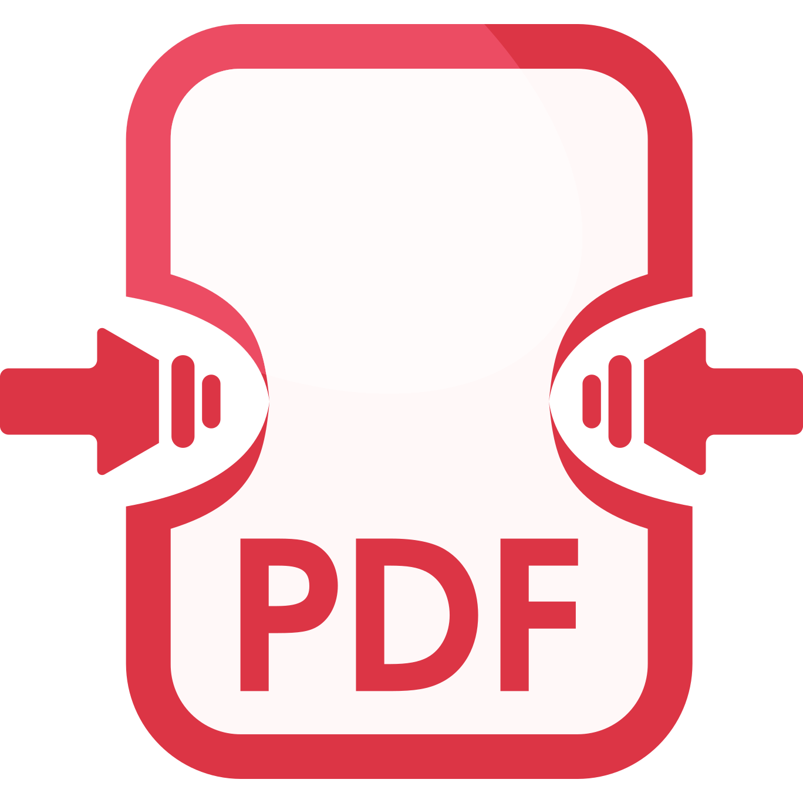
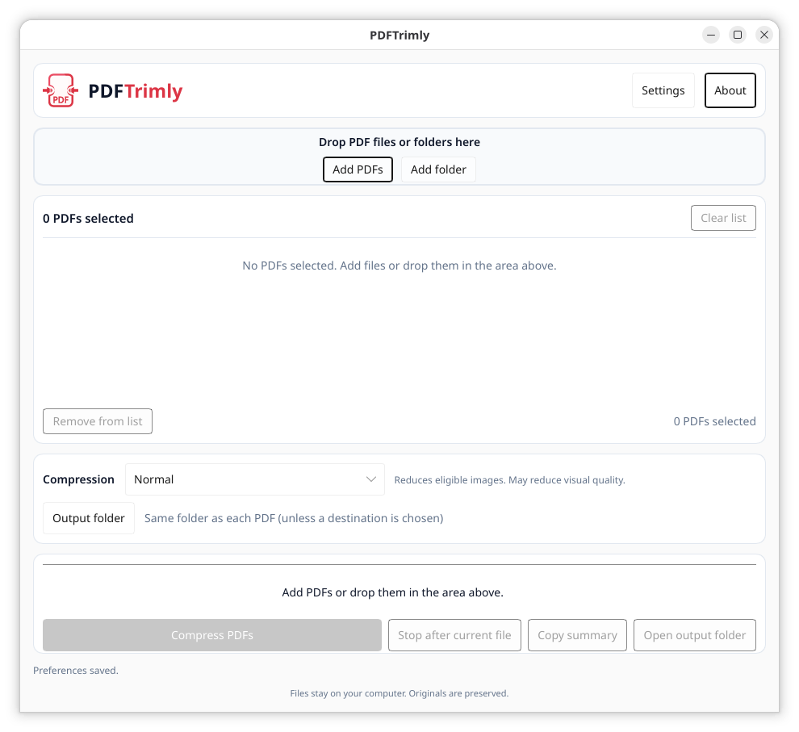

<p align="center">
  
</p>

# PDFTrimly

Local, offline PDF compression for Linux and Windows, developed by Pedro Paulo Reis.

[Website](https://made.pedropaulo.net/projects/pdftrimly/) · [Packaging and installation](docs/packaging.md) · [Release checklist](docs/first-release.md)

PDFTrimly optimizes PDF streams and eligible scan images while preserving existing
searchable text and OCR. It processes files on your computer and leaves originals
untouched.



- Desktop interface with multiple files, folders, drag-and-drop and batch results.
- Light, Normal, Ultra and Maximum compression levels.
- English, Brazilian Portuguese, French, Spanish, Italian and German interfaces.
- Saved language, theme, output folder and compression preferences.
- Command-line interface for individual files.

**0.1.2 is in release preparation.** Linux DEB/AppImage and Windows portable ZIP
packaging is configured. Installation and startup in clean Linux and Windows
systems still require the [verification procedure](docs/clean-install.md).

## Installation

Download the platform artifact from a successful **Actions → Build packages** run
and extract the ZIP. Keep the Windows executable together with `LICENSE` and
`licenses/`. The Windows executable is unsigned.

On Ubuntu 24.04 x86_64:

```sh
sudo apt install ./pdftrimly_0.1.2_amd64.deb
pdftrimly
```

For AppImage setup, platform requirements and checksum verification, see the
[packaging guide](docs/packaging.md). Version tags publish a GitHub prerelease for 0.x after both platform builds
succeed.

## Usage

Open PDFTrimly, select PDFs or a folder, choose an output folder and compression
level, then start the batch. Light preserves image data. Normal, Ultra and Maximum may
reduce image quality. Maximum may make small text in scans difficult to read;
savings depend on the document. Unsupported images are preserved; encrypted
and digitally signed PDFs are rejected. Stopping a batch lets the current file finish.

```sh
pdftrimly --version
pdftrimly compress "input.pdf" "output.pdf" --level normal
```

See [folder input](docs/folder-input.md) and [settings](docs/settings.md) for details.
Visual equivalence across arbitrary PDFs has not been established; check outputs
before using them in place of a working copy.

## Development

Install [Rust stable](https://rustup.rs/), then run from the repository root:

```sh
cargo build --workspace --locked
cargo run --locked
cargo fmt --all -- --check
cargo clippy --workspace --all-targets --locked -- -D warnings
cargo test --workspace --locked
python3 -m unittest discover -s scripts -p 'test_*.py'
```

The independent engine lives in `crates/pdftrimly-core`; desktop code is in `src/`
and `ui/`. See [architecture](docs/architecture.md) and [dependency review](docs/dependencies.md).
Never commit private PDF fixtures.

## License

Project-authored code is licensed under [MIT](LICENSE). Dependencies retain their
own licenses. Slint uses its royalty-free desktop license, with attribution in
the About dialog. Distribution notices and remaining review items are documented
in the [dependency review](docs/dependencies.md).

[Support development on Ko-fi](https://ko-fi.com/pedropaulo)
